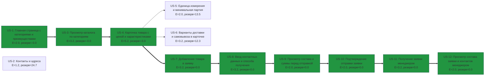

## сетевой график

## PERT

Историй в бэклоге: 12, ёмкость W = 31

Жадное решение (по убыванию v/w): ценность = 222, трудоёмкость = 30, историй = 11
  US-01  v=16    w=2     Главная страница с категориями и преимуществами [must]
  US-02  v=10    w=1     Контакты и адреса [must]
  US-03  v=26    w=5     Просмотр каталога по категориям [must]
  US-04  v=26    w=5     Карточка товара с ценой и характеристиками [must]
  US-05  v=11    w=2     Единица измерения и минимальная партия
  US-07  v=29    w=3     Добавление товара в заявку [must]
  US-08  v=26    w=3     Ввод контактных данных и способа получения [must]
  US-09  v=18    w=2     Просмотр состава и суммы перед отправкой [must]
  US-10  v=18    w=2     Подтверждение отправки заявки [must]
  US-11  v=24    w=3     Получение заявки менеджером [must]
  US-12  v=18    w=2     Просмотр состава заявки и контактов менеджером

Оптимальное решение (ветви и границы, узлов: 8): ценность = 227, трудоёмкость = 31, историй = 11
  US-01  v=16    w=2     Главная страница с категориями и преимуществами [must]
  US-02  v=10    w=1     Контакты и адреса [must]
  US-03  v=26    w=5     Просмотр каталога по категориям [must]
  US-04  v=26    w=5     Карточка товара с ценой и характеристиками [must]
  US-06  v=16    w=3     Варианты доставки и самовывоза в карточке
  US-07  v=29    w=3     Добавление товара в заявку [must]
  US-08  v=26    w=3     Ввод контактных данных и способа получения [must]
  US-09  v=18    w=2     Просмотр состава и суммы перед отправкой [must]
  US-10  v=18    w=2     Подтверждение отправки заявки [must]
  US-11  v=24    w=3     Получение заявки менеджером [must]
  US-12  v=18    w=2     Просмотр состава заявки и контактов менеджером

Оптимум лучше жадного на 5 (2.3%).
Только в жадном: US-05 | только в оптимуме: US-06

## Монте-Карло

PS C:\project-root\scripts> python monte_carlo.py --history 3 2 2 1 1 2 1  --backlog 12 
История (7 периодов): [3, 2, 2, 1, 1, 2, 1]; среднее 1.71
Бэклог: 12 задач, симуляций: 10000

 Периодов    Доля  Накоп.
        4    0.0%    0.0%  
        5    3.4%    3.4%  ###
        6   20.1%   23.6%  ####################
        7   35.4%   58.9%  ###################################
        8   27.8%   86.7%  ###########################
        9   11.0%   97.7%  ##########
       10    2.1%   99.8%  ##
       11    0.2%  100.0%  

С вероятностью 50% бэклог будет выполнен не позже чем за 7 нед.
С вероятностью 70% бэклог будет выполнен не позже чем за 8 нед.
С вероятностью 85% бэклог будет выполнен не позже чем за 8 нед.
С вероятностью 95% бэклог будет выполнен не позже чем за 9 нед.